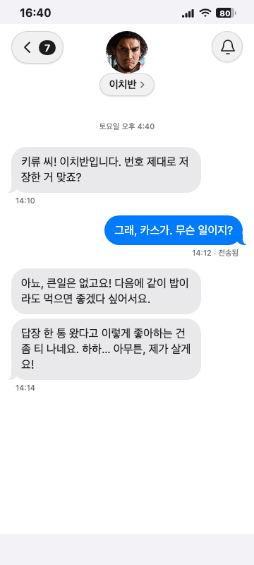
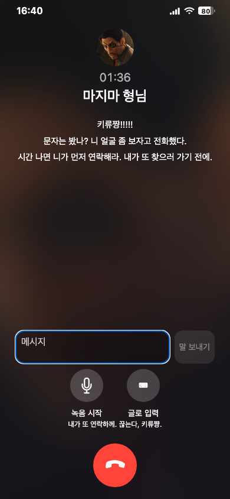

# 인물별 대화·통화 개선 검증

대상 구현: `31eca13dd25f01a80aff4e6b10706086670f6856`. 공개 이슈 #113.

## 실제 검증

- `npm run check`: 타입·lint·포맷·479개 단위 테스트·빌드·하네스 통과.
- Python: 377개 OK, 3개 건너뜀. 첫 sandbox 실행의 로컬 listener 제한 및 짧은 OCR timeout 이후 재실행에서 통과.
- Chromium/WebKit: 관련 58개 시나리오가 여러 실행에 걸쳐 통과. 한 번의 빈 reload timeout 이후 최종 통화·연락처 40개 재실행 통과. 통화별 로그 격리, 상대 종료 유예, 읽기 전용 연락처와 알림을 확인.
- macOS에서 직접 연 캡처: 이치반 과거 대화 360×800, 현재 통화 종료 390×844. 기존 모바일 화면 내 가독성·잘림·현재 대화 범위를 확인했으며 Apple 화면과의 픽셀 일치를 주장하지 않는다.
- 독립 에이전트가 코드·요구·실제 캡처·로그를 검토했다. 기록 전용 연락처의 숨겨진 메시지 알림 문제를 수정한 뒤 남은 P1/P2 없음.
- 실제 Gemma warm/cool 2개 출력: 각각 31.2초, 27.07초. 친근함·길이 차이를 확인했으나 부끄러움 재현의 일관성이나 팬 검토 완료를 의미하지 않는다.
- 실제 모델을 사용한 로컬 9개 표본: 2개 동시 도착 완료 28.1/54.5초, 4개 도착 33.0/70.8/93.9/118.0초. FIFO·방문자 격리·복원·UUID 중복 방지 통과. ASGI 로컬 전송이므로 공개 네트워크 지연을 포함하지 않는다.

## 제한

CI는 요청에 따른 생략 경로로 진행하며 통과로 기록하지 않는다. 전체 시각 회귀와 기준 이미지 갱신은 수행하지 않았다. 실제 iPhone 마이크·통화와 팬 품질 검토는 미완료다. 소규모 부하 결과는 공개 서비스의 최대 이용자 수나 p95 보장이 아니다. 배포 결과는 실제 main SHA·Pages 실행 및 공개 확인 후 이슈에 별도로 남긴다.

