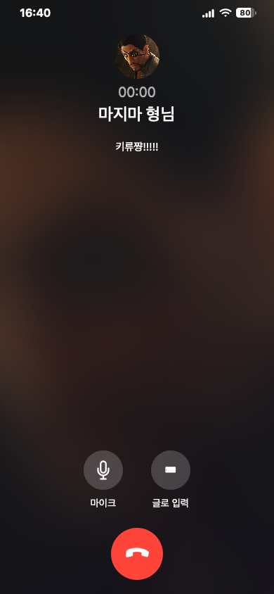

# 통화 마이크 입력·파일 저장 종료 검증

- 범위: 마이크 명칭, SpeechRecognition 입력·수정·전송 유지, 앱 파일 수집/업로드 제거, 기존 업로드 410 차단, 기존 파일 보존.
- 타입 검사·변경 파일 ESLint/Prettier 통과. SpeechRecognition와 gateway 단위검사 26개 통과.
- Python `test_chat_server.py` 26개 통과. Worker/API 본문 미읽기·신규 파일 없음·기존 파일 바이트/수정시각/권한 보존 확인.
- Chromium/WebKit 통화 검사 총26개 통과. 인식 수정·전송·취소·종료·실패·미지원 경로 유지. 합성 인식 이벤트 사용, 앱의 MediaRecorder 생성/getUserMedia 호출/음성 업로드0 확인.
- macOS 390×844 캡처 직접 확인. 마이크 버튼·입력·종료 조작 가시성 유지, 저장 안내와 녹음 문구 제거. Apple 픽셀 일치 비교는 아님.
- 구현에 참여하지 않은 검토자가 소스·캡처·로그를 검토해 남은 P1/P2 없음.
- 전체 `npm run check`, 전체 시각 회귀 및 실제 iPhone 음성 인식 검사는 수행하지 않았다. CI는 요청에 따라 생략하며 통과로 기록하지 않는다. 브라우저 음성 인식 서비스의 외부 처리와 앱 파일 저장 종료를 구분한다.
- Worker/API를 먼저 적용하고 Pages에 같은 main을 배포한 실제 결과는 이슈 #115에 기록한다.

