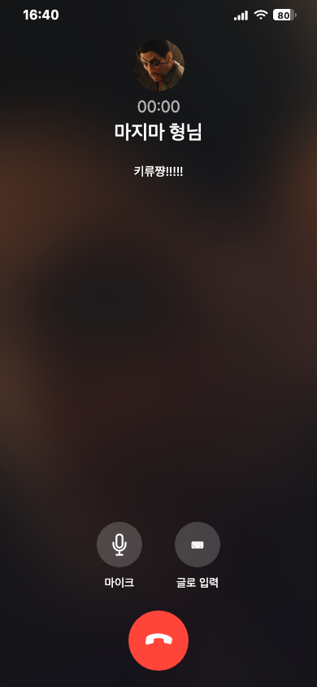
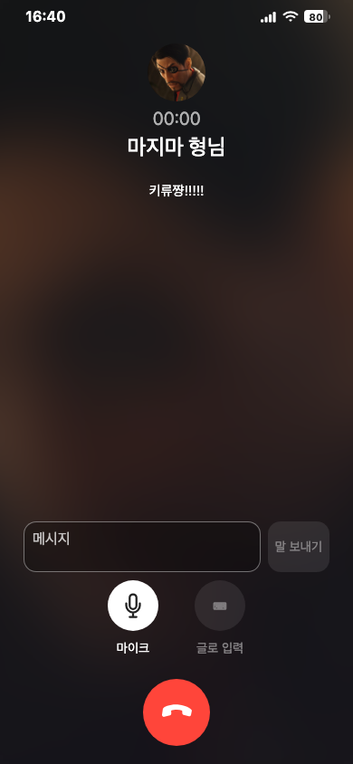

# 마이크로 시작한 음성 파일 저장 복구

- 표시: 마이크 버튼 켜짐/꺼짐 강조와 접근성 상태. 별도 저장 문장·빨간 점 없음.
- 수집: 사용자 탭과 브라우저 권한에 따라 시작. 인식 종료·수동 중단·화면 이탈·통화 종료에 트랙 반납. 늦은 권한 응답 뒤 취소는 저장하지 않음. 한 세션 최대30초/2MiB.
- API: 인증·방문자 격리·시간당30회 제한·UUID 중복/충돌 검사, 기존 파일 보존, 공개 다운로드·문자/RAG편입 없음.
- 실제 로컬 검사: typecheck 및 변경 파일 lint/format, 인식/수집/gateway 단위37개, API28개, Chromium/WebKit 통화26개 통과. 브라우저 합성 입력으로 마이크 누르기 전 수집0, on/off표시, 중단 후 업로드1회를 확인.
- 캡처: macOS Chromium390×844에서 비활성/활성 마이크 직접 확인. 흰색 버튼 강조가 켜짐 상태를 표시하며 종료 버튼이 잘리지 않음.
- 실제 iPhone 인식·수집 동시 실행과 전체 시각 회귀는 미검증. CI는 요청에 따라 생략하고 통과로 기록하지 않음. 공개 배포·합성음원 저장 결과는 이슈에 별도 기록.

