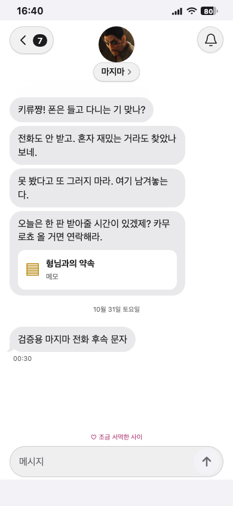
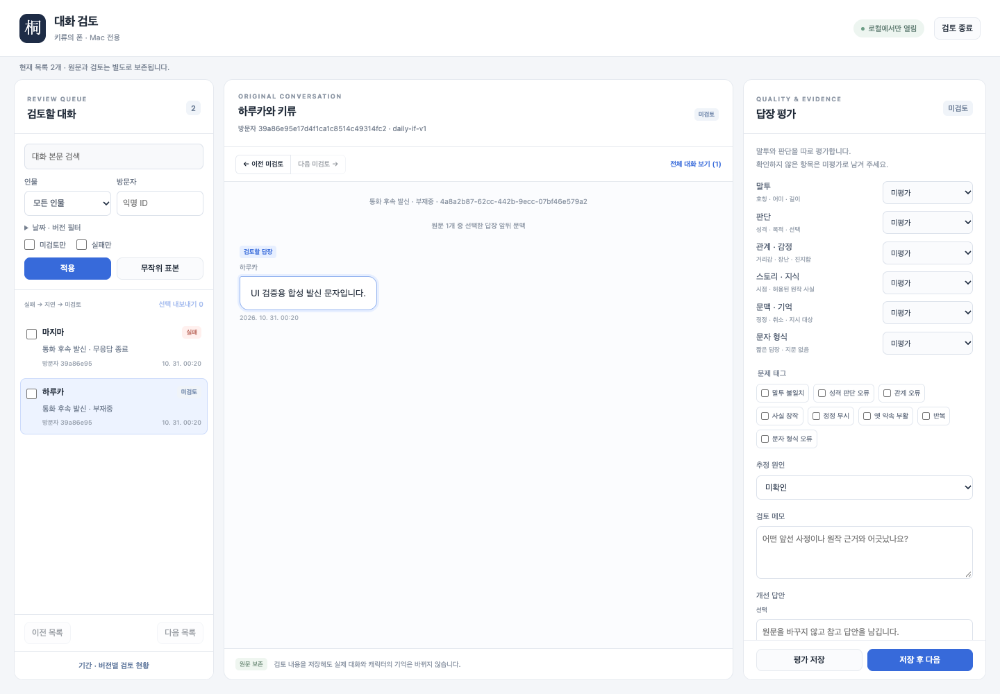
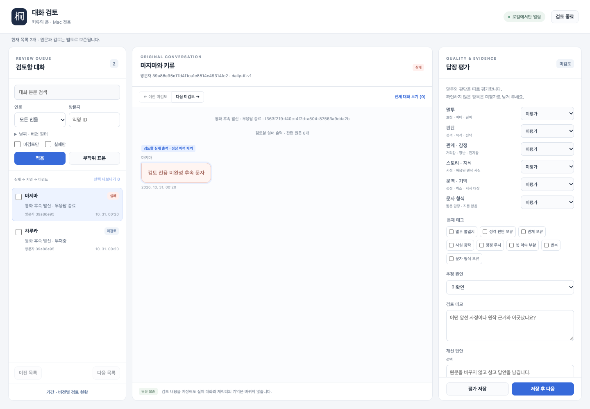

# 통화 무응답과 빠른 AI 발신 문자

## 변경과 검증 범위

마지마의 키류에 대한 끈질긴 관심·재촉을 강화했다. 하루카·마지마 통화는 마지막 활동 뒤 60초 무응답이면 작별하고 6초 후 종료하며, 부재중·수신 거절·무응답 종료 뒤 AI 문자를 보낸다. 음성/권한/생성/전달 대기는 시간을 초기화/유예하고, 실제 텍스트 입력은 시간을 다시 센다. 미전송 초안이나 실패한 요청은 무한히 통화를 유지하지 않는다.

서버는 통화 ID/UUID 중복을 막고 사용자 발언을 만들지 않는다. 정상 대화 쌍과 assistant-only 후속을 분리하며, 후속 문구와 연결 여부·통화 결과를 최근 근거로 다음 모델 입력에 넣는다. 상태 조회가 끊겼으면 기존 job을 다시 조회하고 새 후속을 진행한다. 같은 단일 Gemma FIFO를 유지하고 후속에만 non-thinking/96토큰·추가 표시/푸시 지연 없음 설정을 사용한다.

## 실제 모델 표본

[합성 방문자 출력과 측정](model-smoke.json)은 실제 실행 중인 Gemma 서버로 만든 후속4건과 다음턴1건이다. 후속2.73–4.56초, 다음턴23.67초였다. 4건으로 p95나 일반 품질을 주장하지 않는다. 마지마의 다시 연락하라는 재촉과 연결 후 무응답을 회상하는 다음턴은 이 표본에서 확인했으며, ‘쫌이 야박하게’ 같은 어색한 표현도 남는다. 팬 말투 검토는 미완료다. 실제 방문자 원문은 사용하지 않았다.

## 로컬 검사

- npm check: 타입/lint/포맷/505개 단위/빌드/하네스 통과. 빌드에는 기존 큰 청크 경고가 남는다.
- Python: 389개 실행, 386개 통과·환경 의존3개 skip. schema 1/2→3, 통화별 중복·충돌, 정상 쌍/후속 기억, 실패/잘림, 관리자 내보내기와 순차 생성 검사 포함.
- 초기 sandbox 실행의 포트 오류는 허용된 로컬 실행으로 재검사했고, Vitest 파일을 node --test로 실행한 호출 오류는 정상 npm check 실행으로 확인했다.
- 이전 브라우저 실행 중 별도 빌드가 dist를 재작성했다. 이후 빌드를 고정하여 관련 브라우저 검사를 재실행했고 최종 결과는 PR에 현재 SHA와 함께 기록한다.
- 기존22초 고정 대기 단위 검사는 현행15–30초 랜덤 지연에 맞게32초로 보정했다. 제품 시간을 줄이거나 검사 허용치를 넓히지 않았다.
- Chromium/WebKit 관련54개 중53개 통과 후, 생성대기 테스트의 가상시계/진행 중 fetch 동기화를 수정했다. 해당 시나리오는 두 브라우저에서3회씩6개 반복 통과했다. 다른 실패2건은 고정 빌드 재실행에서 통과했다.
- CI와 전체 스크린샷 회귀는 생략하며 성공으로 기록하지 않는다.

## 화면 직접 검토

macOS Chromium/WebKit의390×844 문자 화면과 Chromium1440×1000 관리자 화면을 직접 열어 확인했다. 기존 iPhone 스타일 말풍선/상단조작/입력창을 유지하고 새 후속은 수신 말풍선 한 건이며 가짜 사용자 말풍선·후속 타이핑 지연이 없다. 관리자는 통화 결과와 assistant-only 성공/실패를 구분하며 실패 출력은 정상 이력에 포함하지 않는다. 기준 이미지 변경은 없다. 실제 iPhone Safari/PWA 실행은 미검증이다.

공개 Pages/API 배포와 공개 실제 Gemma 확인 결과는 이슈에 별도 기록한다.
